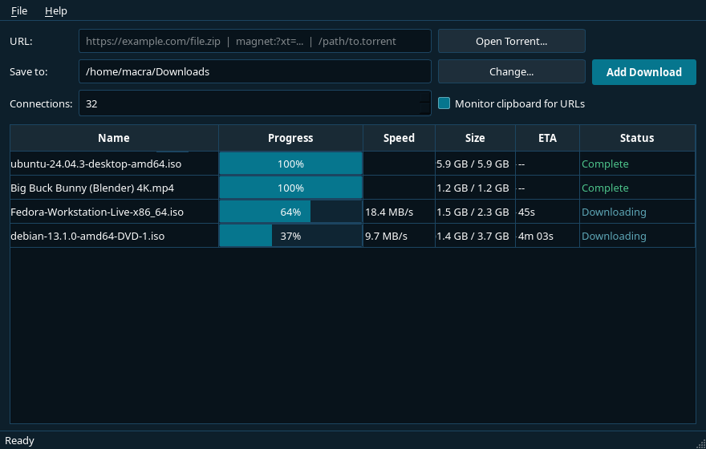

<p align="center">
  
</p>

<h1 align="center">Macra Downloader</h1>

<p align="center">
  <b>Fast, free downloads. No ads, no catch.</b><br>
  A free, open-source download manager for Windows and Linux that is much faster
  than your browser's built-in downloader.
</p>

<p align="center">
  <a href="https://github.com/macrasystems-star/macra-downloader/releases/latest"></a>
  
  <a href="LICENSE"></a>
</p>

<p align="center">
  <a href="https://github.com/macrasystems-star/macra-downloader/releases/latest/download/MacraDownloader-Setup-x64.exe"><b>⬇ Download for Windows</b></a>
  &nbsp;·&nbsp;
  <a href="https://github.com/macrasystems-star/macra-downloader/releases/latest/download/macra-downloader-linux-x64"><b>⬇ Download for Linux</b></a>
  &nbsp;·&nbsp;
  <a href="https://macrasystems-star.github.io/macra-downloader/">Website</a>
</p>

<p align="center">
  
</p>

## Why Macra Downloader?

Browser downloads are slow and fragile. They pull a file over a single
connection, and if your Wi-Fi drops or the browser closes, you often have to
start again from zero. We got tired of that, so we built Macra Downloader and
made it free for everyone.

- **Much faster downloads.** Each file is split into up to **32 parallel
  connections**, so you use your full internet speed.
- **Never start over.** Interrupted downloads resume automatically, even after
  a crash, a reboot or days later.
- **Videos and torrents too.** Download from YouTube and about 1,000 other video
  sites, and open magnet links and `.torrent` files, all in the same app.
- **Hands-free.** Copy a link anywhere and the download starts on its own.
- **Clear progress.** A live progress bar with speed and time remaining for every
  download.
- **Free and private.** No ads, no account, no tracking. Open source under the
  MIT License.

## Download

| System | File | Notes |
|---|---|---|
| **Windows 10/11 (64-bit)** | [MacraDownloader-Setup-x64.exe](https://github.com/macrasystems-star/macra-downloader/releases/latest/download/MacraDownloader-Setup-x64.exe) | Normal installer with Start-menu shortcut and uninstaller |
| **Linux (x86-64)** | [macra-downloader-linux-x64](https://github.com/macrasystems-star/macra-downloader/releases/latest/download/macra-downloader-linux-x64) | Single self-contained file, no Python needed (`chmod +x` then run it) |

All versions are on the [Releases page](https://github.com/macrasystems-star/macra-downloader/releases).

> **Windows SmartScreen:** the installer is not code-signed yet, so Windows may
> show *"Windows protected your PC"*. Click **More info → Run anyway**. You can
> check the download against the `SHA256SUMS.txt` file published with each release.

## How to use it

1. Paste a link into the **URL** box (or just copy one, and the app picks it up).
2. Choose where to save it.
3. Press **Add Download**.

That's it. Plain files, video pages, magnet links and `.torrent` files all go
in the same box, and the app works out what to do with each.

## ⚠ Use responsibly

Macra Downloader is a general-purpose tool. Only download content you own, that
is freely licensed, or that you otherwise have permission to download. You are
responsible for following copyright law and the terms of service of the
websites you use. Some sites, including some video platforms, do not allow downloading
in their terms. The app does **not** bypass DRM or any other copy protection.
See [DISCLAIMER.txt](DISCLAIMER.txt).

---

# For developers

## Run from source

```bash
# Run it (double‑click in your file manager, or from a terminal):
./dist/download-manager

# Or point it at the source directly:
python3 download_manager_gui.py
```

Give the app a URL, choose a save folder, pick the number of parallel connections
(1–32, **default 32**), press **Add Download**, and watch the progress bar,
speed, total size and **ETA** column fill in as your file downloads.

Paste a **magnet link**, a bare **btih hash**, a **.torrent file path**, or an
http(s) URL ending in **.torrent** and it is routed through the libtorrent
engine instead (same progress/speed/ETA table):
`pip install libtorrent` or `sudo apt install python3-libtorrent`.

URLs to **video sites** (~1000 sites supported by yt-dlp) are detected
automatically and routed through yt-dlp; the app still shows a single live
progress bar, speed and ETA for them. yt-dlp needs **ffmpeg** on the system to
merge the best video + audio into one MP4
(Linux: `sudo apt install ffmpeg`; Windows: `winget install ffmpeg`). Without ffmpeg the app falls back to the best
single-file format automatically.

**Extras**
- **ETA column** — an estimated-time-left countdown updates live while a
  download is running, with smoothed (calm, non-jumpy) speed & ETA readouts.
- **Delete File** — right-click a finished download → *Delete File* to remove it
  straight from the app (with a confirmation prompt).
- **Database + resume** — every download is recorded in a local SQLite database
  (Linux: `~/.local/share/download_manager/downloads.db`,
  Windows: `%LOCALAPPDATA%\MacraDownloader\downloads.db`). Interrupted plain-file
  downloads keep their partial `.part` files on disk, so the next time you open
  the app they are **picked up and resumed automatically** — even days later.

> Note: the xcb (X11) rendering path needs `libxcb-cursor0` on some distros.
> `sudo apt install libxcb-cursor0` if the packaged app won't show a window.

## What's in the box

| File                     | Purpose                                                        |
|--------------------------|----------------------------------------------------------------|
| `download_manager.py`    | Headless core: range splitting, streaming, resume, combining   |
| `download_manager_gui.py`| Windows‑style Qt GUI (entry point for the executable)          |
| `media_downloader.py`    | yt-dlp engine for YouTube & friends (title, progress, merge)  |
| `torrent_downloader.py`  | libtorrent engine: magnets, .torrent files/URLs, hashes       |
| `download_store.py`      | SQLite store: persists downloads so they can resume later      |
| `test_download_manager.py`| Self‑contained unittest suite using a local Range HTTP server |
| `requirements.txt`       | Python deps needed to run the source directly                  |
| `run.sh`                 | Convenience launcher that prefers the built binary             |
| `pyproject.toml`         | pip-installable package (`pip install .`, `download-manager`) |
| `download-manager.desktop`| Linux desktop entry: magnet + .torrent handler                |
| `install.sh`             | System install: pip pkg + desktop entry + MIME registration   |
| `uninstall.sh`           | Removes what install.sh installed                              |

## Install it (Linux Mint / Ubuntu)

```bash
./install.sh
# launches as: download-manager
# handles: download-manager "magnet:?xt=..." / "https://.../x.torrent"
```

This registers the app for `magnet:` links and `.torrent` files, puts a
launcher in your app menu, and adds the `download-manager` command to PATH.

## Automatic URL capture

1. **Clipboard monitor (built in, on by default)** — copy any http(s),
   magnet, or .torrent link anywhere and the app fills the URL box and
   starts the download. Toggle with the *Monitor clipboard for URLs*
   checkbox.
2. **Command-line / .desktop hook** — the app accepts one URL argument:
   `download-manager "<URL-or-magnet>"`, so any browser extension or
   script can hand links to it.
3. **Browsers** — see [Browser integration](#browser-integration) below.
   The desktop file also advertises
   `MimeType=application/x-bittorrent;x-scheme-handler/magnet;` so magnets
   and .torrent files open in the app once installed.

Only one Macra Downloader window runs at a time: starting it again (or
handing it a link) brings the open window forward and adds the link there.

## Browser integration

The **Macra Downloader extension** (folder `browser_extension/`, one copy for
Chrome, Edge, Brave, Chromium and Firefox 128+) sends the downloads you start
in the browser to Macra Downloader, together with the site's cookies, the
referring page and the browser's user agent, so downloads behind a login keep
working. The browser's own copy is cancelled. It also adds *Download with Macra
Downloader* to the right-click menu of links.

- Click the extension's toolbar button to turn the hand-over off (badge *off*)
  or on again.
- Downloads from private / incognito windows always stay in the browser.
- If Macra Downloader cannot take a download (not installed, helper not set
  up), the browser downloads it as usual and the button shows a red **!**.

The extension talks to a small helper, `native_host.py`
(`MacraDownloaderHost.exe` on Windows), that browsers start through "native
messaging". The helper only answers this extension and passes the request to
the Macra Downloader window over a local connection protected by a per-user
secret; it starts the window if it is not open.

**Setting it up**

- **Windows:** the installer registers the helper for Chrome, Edge, Brave,
  Chromium and Firefox. Add the extension from your browser's add-on store.
- **MacraOS:** everything is preinstalled; Brave, Chrome and Chromium get the
  extension automatically (they then show *Managed by your organization*).
  Macra Browser hands its downloads over by itself (menu: *Send downloads to
  Macra Downloader*).
- **Other Linux / running from source:** *Help → Browser Integration...*
  registers the helper for the browsers it finds in your home folder. To try
  the extension before it is in a store, load `browser_extension/` with
  *Load unpacked* (Chrome/Edge/Brave, Developer mode) or
  *about:debugging → Load Temporary Add-on* (Firefox).

The store package (without the developer `key` field) is attached to each
release as `macra-downloader-extension-<version>.zip`
(`python3 tools/package_extension.py OUT.zip`). After publishing in the Chrome
Web Store or Edge Add-ons, add the store's extension ID to
`CHROMIUM_EXTENSION_IDS` in `browser_setup.py` and regenerate the Windows
manifests (the tests check they match).

## Updates

Once a day the app asks GitHub whether a newer release exists (turn it off in
*Help → Check for Updates Automatically*). If there is one, an *Update
available* button appears in the status bar. On Windows it can download the
installer, check it against the release's `SHA256SUMS.txt` and start it;
elsewhere it opens the download page. Copies that came with MacraOS are
updated by MacraOS.

## Building releases

Pushing a version tag (for example `git tag v1.2.1 && git push origin v1.2.1`)
runs [.github/workflows/release.yml](.github/workflows/release.yml), which
builds the Windows installer on a GitHub-hosted Windows machine with
PyInstaller + Inno Setup, builds the Linux executable, and publishes both, plus
`SHA256SUMS.txt`, as a GitHub Release. The website in [website/](website/) is
deployed to GitHub Pages by [.github/workflows/pages.yml](.github/workflows/pages.yml).

To build the Windows installer by hand on a Windows PC, see
[packaging/windows/build.ps1](packaging/windows/build.ps1).

### Build the Linux single-file executable yourself

```bash
python3 -m venv venv
. venv/bin/activate
pip install -r requirements.txt pyinstaller
pyinstaller --onefile --windowed --name download-manager \
    --hidden-import=download_manager \
    --collect-all yt_dlp \
    download_manager_gui.py
# result: dist/download-manager
```

## Run the tests

```bash
python3 -m unittest test_download_manager -v
```

Tests are fully offline: they spin up an embedded HTTP server that understands
`Range`, `HEAD` and `Accept-Ranges`, and verify multi‑connection downloads,
non‑range fallback, unknown‑size fallback, part‑file cleanup, and resume from
pre-existing `.part` files.
## License

Macra Downloader is © 2026 Macra Systems and released under the
[MIT License](LICENSE). It bundles open-source components under their own
licences (Qt/PySide6 under LGPL-3.0, yt-dlp, libtorrent, requests, and others).
See [THIRD_PARTY_NOTICES.md](THIRD_PARTY_NOTICES.md).

## Privacy

The app collects no personal data and sends nothing to Macra Systems. Torrent
downloads make your IP address visible to other peers, as with any BitTorrent
program. See [PRIVACY.md](PRIVACY.md).
